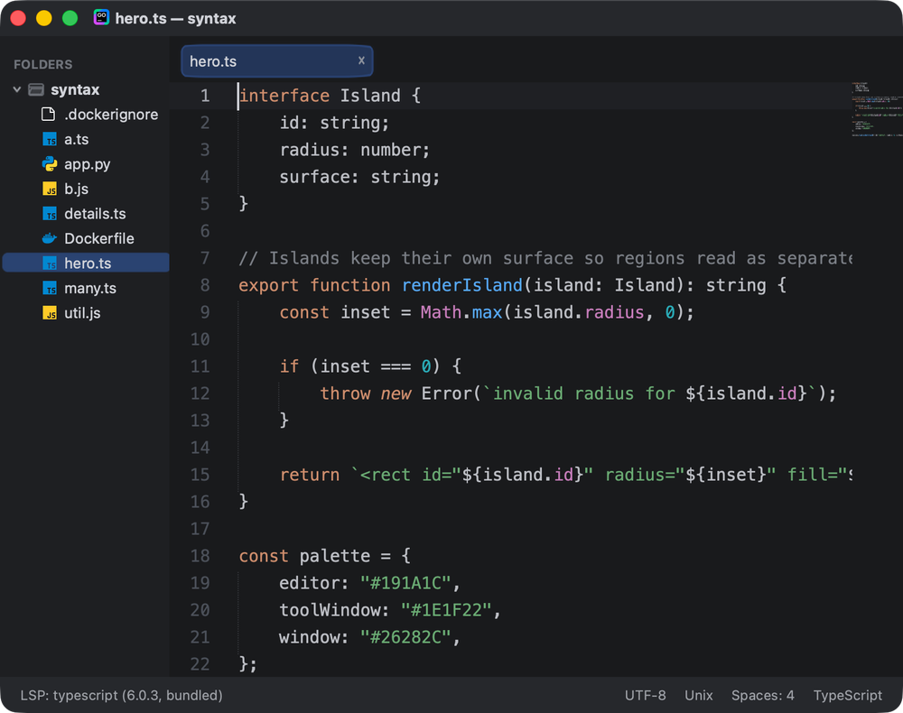
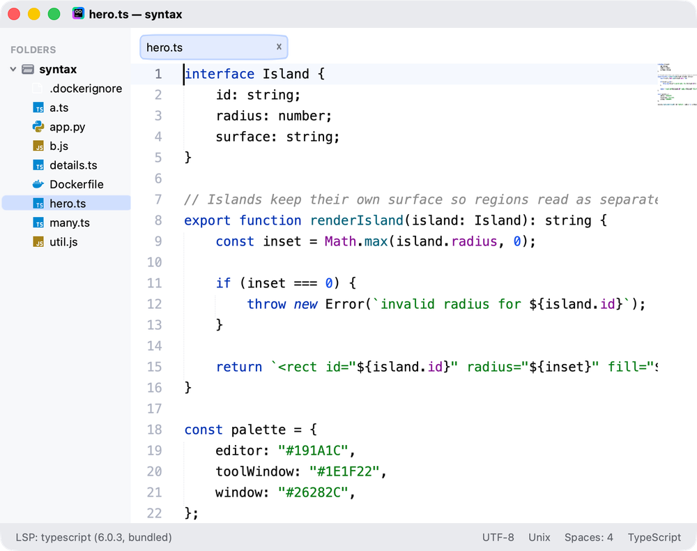

# JetBrains Islands for Sublime Text 4

IntelliJ IDEA's **Islands** interface, rebuilt with Sublime Text's own theme
mechanism. One install ships both flavours; nothing patches the app, injects
code, or touches its signature.

| Islands Dark | Islands Light |
|---|---|
|  |  |

## Why this exists

Most "JetBrains themes" are just a palette swap. This one is built the other
way round: the palette comes from IntelliJ's published Islands tokens, and the
UI rules were measured against real IntelliJ screenshots — tab pill geometry,
island gaps, popup hairlines — then re-derived for Sublime's control inventory.

## What you get

| | Dark | Light |
|---|---|---|
| UI theme | `JetBrains Islands Dark.sublime-theme` | `JetBrains Islands Light.sublime-theme` |
| Color scheme | `JetBrains Islands Dark.sublime-color-scheme` | `JetBrains Islands Light.sublime-color-scheme` |
| File icons | `JetBrains Islands Dark.sublime-file-icons` | `JetBrains Islands Light.sublime-file-icons` |

138 file-type icons, retina-ready at `@2x`/`@3x`, contrast-corrected to at
least 3:1 against both backgrounds.

## Install

### Package Control

1. `Cmd+Shift+P` → **Package Control: Add Repository** → paste this repo URL.
2. `Cmd+Shift+P` → **Package Control: Install Package** → **JetBrains Islands**.

### Manual

```bash
git clone <repo-url> ~/Library/Application\ Support/Sublime\ Text/Packages/JetBrains\ Islands
```

## Activate

`Cmd+Shift+P` → **JetBrains Islands: Switch to Dark** (or **Switch to Light**).

The command flips the UI theme, the color scheme, and the Islands tab layout in
one save. Prefer editing settings by hand? Copy the keys from
`settings/JetBrains Islands Dark.sublime-settings` into
`Packages/User/Preferences.sublime-settings`.

**Follow the system appearance:** **JetBrains Islands: Follow System
Appearance** sets `theme: "auto"` with both flavours paired, so macOS Dark/Light
switching lands on the matching Islands flavour.

Do not set `file_icon_theme` yourself — the icon mapping whose name matches the
active theme loads automatically, and pinning one forces its variants in both
flavours.

## Measured against IntelliJ

Every value below was sampled from a live Sublime window and compared with an
official IntelliJ Islands capture. Details in
[docs/VISUAL-REFERENCE.md](docs/VISUAL-REFERENCE.md).

| | Dark | Light |
|---|---|---|
| Window / status bar | `#26282C` | `#E9EAEE` |
| Tool window | `#1E1F22` | `#F7F8FA` |
| Editor | `#191A1C` | `#FFFFFF` |
| Selected tab fill | `#233558` | `#E3EBFE` |
| Selected tab border | `#2E4D89` | `#A7C5FF` |
| Selection row | `#2A4371` | `#D0DFFE` |

The selected tab is a pill, not a full-bleed block — matching IntelliJ's
`EditorTabs.underlinedTabBackground` design. Pill padding is calibrated to
8.5 pt left / 8.0 pt right on retina captures.

## Known limits

Three things cannot be reproduced, and the reasons are documented rather than
hidden:

- **Island gap between sidebar and editor.** Sublime draws no gap there;
  `grid_layout_control` only covers editor splits, and a 1 px texture stretches
  into a band. The two surfaces differ in colour instead (`#1E1F22` vs `#191A1C`).
- **Tool window stripe** (the Project/VCS/Structure icon column). No matching
  theme class exists.
- **Minimap toggle.** `show_minimap` is an internal view flag, not a documented
  setting; only `View > Hide Minimap` turns it off, per view.

Also, Sublime has no file-type icon in tabs and no breadcrumb bar, so tabs are
narrower than IntelliJ's and the status bar's left side stays Sublime-native.

## Documentation

| | |
|---|---|
| [Installation](docs/INSTALLATION.md) | full install, uninstall, restore |
| [Design](docs/DESIGN.md) | token table and per-surface layer notes |
| [Color system](docs/COLOR-SYSTEM.md) | every UI token and editor token |
| [Icons](docs/ICONS.md) | source, licence, contrast pass, coverage |
| [Visual reference](docs/VISUAL-REFERENCE.md) | measured screenshots and acceptance |
| [Compatibility](docs/COMPATIBILITY.md) | Sublime dependencies, what breaks on upgrade |
| [Development notes](docs/DEVELOPMENT-NOTES.md) | build, testing loop, gotchas |
| [Design spec](docs/DESIGN-SPEC.md) | the original 1084-line project requirements |

## Build from source

```bash
python3 scripts/gen_textures.py         # textures/*.png (+ @2x/@3x)
python3 scripts/build_themes.py         # both themes + both icon mappings
python3 scripts/build_color_schemes.py  # both color schemes
python3 scripts/verify_package.py       # offline validation
```

`build_themes.py` needs Pillow. Icon rasterisation additionally needs
`MATERIAL_ICONS` pointing at a Material Icon Theme 5.40.0 checkout and `resvg`;
the generated PNGs are committed, so a normal build does not need them.

Everything under `.sublime-theme` and `.sublime-color-scheme` is generated — edit
the scripts, not the output.

## Credits

File icons from [Material Icon Theme](https://github.com/material-extensions/vscode-material-icon-theme)
5.40.0 (MIT), re-rasterised and contrast-adjusted. See
[THIRD-PARTY-NOTICES.md](THIRD-PARTY-NOTICES.md).

Not affiliated with JetBrains. IntelliJ IDEA is a trademark of JetBrains s.r.o.

## License

MIT — see [LICENSE](LICENSE).
